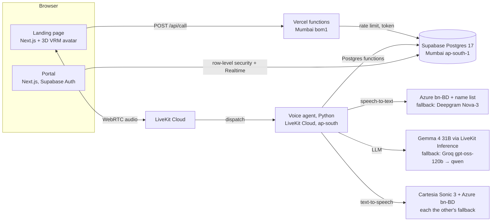

# ByteVoice Bangladesh — a Bangla AI receptionist for dental clinics

A working demo of StrategyByte's ByteVoice for Bangladesh: a live Bangla voice receptionist that books, reschedules and cancels real appointments, a landing page with a 3D receptionist and a live slot board, and a staff portal with every call's transcript and structured data.

| | Link |
|---|---|
| Landing page + Bangla caller | https://bytevoice-bd.vercel.app |
| Clinic portal | https://bytevoice-bd.vercel.app/portal (reviewer login is in the submission email) |
| Video overview (3 min) | https://www.loom.com/share/2bdaedee5a1a4a7f93fb1a71fec8659d |
| Decisions and testing | [docs/DECISIONS.md](docs/DECISIONS.md) · every guard: [docs/GUARDS.md](docs/GUARDS.md) |

**Stack:** Next.js 16 on Vercel · LiveKit Cloud + LiveKit Agents (Python) · Azure `bn-BD` speech-to-text and voice (Deepgram / Cartesia fallbacks) · Gemma 4 via LiveKit Inference (Groq fallback) · Supabase Postgres 17 (Mumbai).

## Engineering highlights

- **Speech recognition chosen by measurement, not reputation.** On 50 Bangladeshi-name clips, Azure `bn-BD` with a common-name phrase list got 48 right vs Deepgram's 38; Deepgram tended to split names into ordinary words ("ফেরদৌস" → "ফের দোষ"). Deepgram stays as the automatic fallback.
- **Correctness lives in the database, not the prompt.** A Postgres exclusion constraint makes double-booking impossible even under concurrent calls; each treatment blocks the doctor for its real length (a 60-min root canal at 12:00 also closes 12:30); doctors' chamber days come from the schedule table.
- **The model is never trusted with facts it can get wrong.** Times, dates and phone read-backs are generated in code; the agent confirms the name and the number and reads back the full booking before calling the booking function; outcomes in the portal come from what the database actually did, not from what the model claimed.
- **Every provider has a free fallback, and silent failures are detected.** Speech recognition, LLM and voice each fall back automatically; a watchdog notices when recognition goes quiet (no error, so no automatic fallback) and replaces the session in ~0.1 s.
- **Tested like a phone system.** Scripted live-audio callers ran every flow (booking, cancel, reschedule, names, numbers, off-topic, goodbyes, recognition stalls) against the local *and* the deployed agent, and the cloud logs were checked after each deploy; three bugs were found that way and fixed (see [DECISIONS.md](docs/DECISIONS.md)).
- **Measured, not guessed:** median reply ~2.7 s on the deployed agent (12 calls, 103 replies); free-tier budgets worked out for a ~25-call review.

The demo clinic is **রাকিব ডেন্টাল কেয়ার (Rakib Dental Care), Dhanmondi**: three doctors, eight services, Saturday–Thursday chambers, closed on Friday. All clinic, doctor and patient data is fictional.

### Quick evaluation path
1. Open the [landing page](https://bytevoice-bd.vercel.app) and pick a free slot in *আমাদের চিকিৎসকবৃন্দ* (or just press the call button).
2. Press **কল শুরু করুন** and allow the microphone. The first call after a quiet period takes about 20 s to connect (free tier waking up).
3. Book by voice: the receptionist reads back your name, mobile number and the full booking before confirming. The slot turns grey on the page during the call.
4. Open the [portal](https://bytevoice-bd.vercel.app/portal): the call appears with its transcript, English translation and extracted fields.
5. Call again with the same mobile number and cancel or move the appointment.

---

## Architecture



**One call, end to end**

1. The visitor presses the call button. `/api/call` checks a per-visitor rate limit (20/hour, IP stored only as a salted hash), creates a fresh LiveKit room and returns a 10-minute token with the agent dispatched into that room.
2. The agent joins, inserts a `calls` row, and greets in Bangla. Every spoken line is written to `transcript_turns` as it happens, so a live call shows up in the portal immediately.
3. Bookings go through **Postgres functions** (`book_appointment`, `reschedule_appointment`, `cancel_appointment`, `find_appointments`, `available_slots`), so the rules live in one place and each change is a single transaction. Every tool call is logged in `tool_invocations`.
4. When the caller hangs up, one LLM request turns the transcript into JSON (intent, names in Bangla and English, phone, reason, preferred time, outcome, flags, summaries, line-by-line English translation). It is validated with Pydantic and Postgres checks before it is stored in `call_extractions`.
5. The portal (Supabase Auth + row-level security) updates live through Supabase Realtime; the landing page's slot board updates mid-call as soon as the agent books, moves or cancels.

## Why these providers

Everything runs on free tiers. Each choice was tested, not assumed:

| Part | Choice | Why |
|---|---|---|
| Speech-to-text | **Azure `bn-BD`** + ~200 common Bangladeshi names, fallback **Deepgram Nova-3** | Best on Bangladeshi names in a side-by-side test (48/50 vs 38/50); also handles numbers said in Bangla, English or mixed |
| LLM | **Gemma 4 31B** on LiveKit Inference, fallback **Groq** | Most natural Bangla of the free models, no per-minute token cap, ~0.9 s to first token |
| Voice | **Azure `bn-BD-PradeepNeural`** and **Cartesia Sonic 3**, each the other's fallback (`TTS_ORDER`) | Both trained on Bangladeshi speech; the live demo runs Azure first to stay within free limits |
| Realtime | **LiveKit Cloud** + LiveKit Agents 1.8 | WebRTC, interruptions, agent dispatch and hosting in one place |
| Database / auth | **Supabase** Postgres 17, Mumbai | Closest region to Bangladesh; auth, row-level security and Realtime included |
| Web | **Next.js 16** on **Vercel** (Mumbai) | One app for landing page, APIs and portal |

The tests and numbers behind each choice are in [docs/DECISIONS.md](docs/DECISIONS.md).

## Making it sound Bangladeshi, not Kolkata

- **Voice:** Bangladeshi-trained voices only (Azure `bn-BD` in the live demo, Cartesia as the alternative).
- **Prompt written in Bangla**, with Dhaka-style example replies and a list of words to avoid (জল, স্নান, আজ্ঞে → পানি, গোসল, জি). The opening greeting is always আসসালামু আলাইকুম; a caller who says নমস্কার gets নমস্কার back and "ভালো থাকবেন" at the end. Models copy the register of their instructions, so English instructions produced translated-sounding Bangla.
- **Safety net in code** (`agent/src/bangla.py`): those words are swapped before speech; `ডা.` is read as "ডাক্তার"; for Azure only, "সাড়ে পাঁচটা" is said as "পাঁচটা তিরিশে" because that voice mispronounces সাড়ে.
- **Times, dates and phone numbers are generated in code** ("রবিবার, ৮ নভেম্বর, বিকাল সাড়ে পাঁচটা", "শূন্য এক সাত এক দুই, তিন চার পাঁচ…"), so the LLM never formats or reads digits itself.
- English words are mixed in the way Dhaka speakers do: appointment, slot, scaling, root canal.

## Conversation behaviour

- Greeting → service → day and time (resolves "আগামী রবিবার বিকালে" from a calendar in the prompt; Friday is closed) → real free slots from the database → name, confirmed back → mobile number (said in parts is fine; read back digit by digit) → **full summary and "ঠিক আছে?" before booking** → confirmation → goodbye.
- **Doctors' chamber days are checked first:** when a caller names a day, the agent checks that a doctor for that treatment sits then before asking the time ("সোমবার রুট ক্যানেল হয় না; ডাক্তার নুসরাত জাহান রবিবার, মঙ্গলবার… বসেন").
- Reschedule and cancel look the appointment up by phone, and the database checks the phone owns it; cancelling never asks for a reason.
- **No medical advice:** declines and offers an appointment or a staff callback. Emergencies (bleeding, swelling, fever) → go to a hospital now, and an `emergency` callback is created.
- **Off-topic questions** (weather, cricket, politics) are politely declined; asked who it is, it says honestly that it is the clinic's AI assistant. Repeated pranks or abuse → one warning, then it ends the call.
- Silence → "হ্যালো, আপনি কি শুনতে পাচ্ছেন?", then a polite hang-up. Calls are capped at 5 minutes.
- After "আল্লাহ হাফেজ" the line stays open 4 s: if the caller says anything, the conversation carries on.
- Interruptions: speaking over the agent stops it; short sounds like "জি"/"হুঁ" don't.

## Data model

14 tables + one view, in `supabase/migrations`. The portal's **Data model** page shows them with live row counts.

| Group | Tables |
|---|---|
| Clinic | `clinics`, `doctors`, `services`, `doctor_services`, `doctor_schedules` |
| Calls | `calls` (status, outcome, flags, summaries, `quality`), `transcript_turns` (Bangla + English, offset, interrupted, response time), `call_extractions`, `tool_invocations` |
| Bookings | `patients`, `appointments`, `appointment_events` (booked → rescheduled → cancelled, old/new time, which call), `callbacks` |
| Access | `staff` (admin / receptionist, linked to Supabase Auth) |

**Rules enforced by the database, not by the model**

- **Bookings take the treatment's real length:** slots start every 30 minutes, and each service has its own duration (check-up 20 min, scaling/filling/extraction 30 min, root canal/whitening 60 min). A 60-minute booking at 12:00 also closes 12:30 for that doctor; only start times where the whole treatment fits are offered.
- **No double booking:** an `EXCLUDE USING gist (doctor_id WITH =, tstzrange(starts_at, ends_at) WITH &&) WHERE status = 'scheduled'` constraint — tested by forcing an overlapping insert.
- **Phone numbers:** `normalize_bd_phone()` accepts Bangla or English digits, `+880`/`880`/`0` prefixes and stores only `+8801[3-9]XXXXXXXX` (CHECK constraint).
- **Families share phones in Bangladesh,** so a patient is matched on phone *and* name.
- Times are stored in UTC and shown in Asia/Dhaka.
- The extraction is not trusted blindly: invalid fields are dropped and listed in `validation_errors`, and an outcome of *booked* only counts if a booking actually happened in the database.

## Clinic portal

What a receptionist sees after the AI has handled calls. Read-only for the reviewer account (row-level security); times in Dhaka; pages update live while a call is in progress.

| Page | What it shows |
|---|---|
| **Dashboard** | Last 7 days at a glance: calls, bookings, open callbacks, average call length and reply time, interruptions handled, outcome breakdown, upcoming appointments, latest calls |
| **Calls** | Every call, newest first; search by name or phone, filter by outcome (booked, rescheduled, cancelled, enquiry, follow-up needed, incomplete, spam), flag (off-topic, medical question, emergency, abuse…) and date range |
| **Call detail** | Summary in Bangla and English; extracted fields (intent, patient, phone, reason for visit, preferred time, needs-human, flags, sentiment, confidence); call quality (reply times, voice and model used, recognition restarts); appointments changed in the call; every action the AI took with its input and result; the full transcript with an English translation of each line |
| **Appointments** | Upcoming or all (including cancelled and past), filter by doctor; each shows patient, phone, service and fee, doctor, status, its history (booked → rescheduled → cancelled) and a link to the call that made it |
| **Callbacks** | Requests the AI is not allowed to handle (medical questions, complaints, emergencies, unclear numbers), with the reason and number; staff mark them done |
| **Patients** | One record per person; families sharing a phone get separate records (matched on phone **and** name); calls and appointments per patient, first seen |
| **Data model** | Every table, its purpose, key columns and relationships with live row counts, and a link to the full schema |

## Measured call quality

Every reply's timing comes from LiveKit's per-turn metrics and is stored on the call; the portal shows a **Call quality** box per call and "replied in 1.4s" on each agent line.

| Measured on the deployed agent, 5 Nov 2026 (12 calls, 103 replies; Cartesia and Azure voices) | median |
|---|---|
| Caller stops → agent starts speaking | **2.7 s** (plain replies ~2.3 s; replies that check the database ~4 s, with an instant "জি, দেখছি…" first) |
| Breakdown | end-of-speech wait 1.0 s · first LLM token 0.9 s · first audio 0.1 s |
| Interruptions | handled (stops and listens) |

The wait for the end of speech is deliberately 0.8 s (2 s while a phone number is being read) because Bangla speakers pause mid-sentence and shorter values cut callers off in testing. To make waits feel shorter, the agent starts drafting while the caller finishes, and says "জি, একটু দেখছি…" immediately when it checks the database. For context, the BanglaTalk research assistant reports 4.9 s end-to-end.

## Security

- No secrets in the repository: keys live in `.env.local` (git-ignored), LiveKit agent secrets and Vercel environment variables. `.env.example` lists the names.
- Row-level security on every table: signed-out users read nothing; staff see only their clinic; only the agent's database role can call the booking functions.
- The public slot board (`/api/availability`) returns doctor, time and booked/free only — no patient data.
- Rate limit on starting calls, 5-minute call cap, short-lived room-scoped tokens.

## Repository

```
agent/      Python voice agent (LiveKit Agents)
  src/agent.py       session, tools, timing, end-of-call processing
  src/prompt.py      Bangla system prompt
  src/bangla.py      spoken dates/times/phones, word fixes, spoken-number parser
  src/voice.py       STT / LLM / TTS chains with fallbacks
  src/extraction.py  post-call structured extraction + validation
  src/db.py          asyncpg access to the Postgres functions
web/        Next.js 16 app: landing page, /api/call, /api/availability, /portal
supabase/   SQL migrations and seed (the schema is the source of truth)
scripts/    shrink_vrm.py — shrinks VRM textures without dropping VRM data
docs/       CREDITS.md
```

## Running it locally

```bash
# database: apply supabase/migrations/*.sql in order, then supabase/seed.sql
cd agent && cp ../.env.example .env.local   # fill in keys
uv sync && uv run src/agent.py download-files
AGENT_NAME=bytevoice-bd-dev uv run src/agent.py dev     # or: uv run src/agent.py console

cd ../web && npm install                    # .env.local with LiveKit/Supabase values,
LIVEKIT_AGENT_NAME=bytevoice-bd-dev npm run dev   # then open http://localhost:3000
```

Deploy: `lk agent create --project <project> --secrets-file … --region ap-south` for the agent; `vercel deploy --prod` from `web/` (region pinned to `bom1` in `vercel.json`).

## Honest limitations

- **Correcting one digit** ("শেষেরটা ওয়ান হবে") isn't understood: the caller has to say the whole number again. After a few failed tries the agent offers a staff callback instead of looping.
- **Rare names** can still be misspelt; the read-back catches most, and unconfirmed names are flagged for staff.
- **Demo calls stop at 5 minutes** to protect the free credits.
- **Latency is about 2 s** per reply on free models; a paid real-time model or a turn detector trained on Bangla would cut the end-of-speech wait.
- **Free tiers:** Cartesia's free plan covers about 20 minutes of speech a month and LiveKit Inference about $2.50 of LLM credit; both fall back automatically (Azure voice, Groq LLM) when exhausted.
- Lip movement on the 3D avatar is driven by "agent is speaking" plus audio level, not true phoneme lip-sync.
- No recordings are stored (privacy by default); the `recording_url` column is ready for it.
- Not production hardening: no SMS confirmations, no clinic-software integration, a single demo clinic.

## Credits

3D character: *Sakurada Fumiriya* by pixiv (VRoid), used under its VRoid Hub licence (free use, credit not required). Everything else is original or open-source; see [docs/CREDITS.md](docs/CREDITS.md). Every guard and corner case is listed in [docs/GUARDS.md](docs/GUARDS.md). What I decided and how each choice was tested: [docs/DECISIONS.md](docs/DECISIONS.md). Code was written with help from Claude (Anthropic); I can explain every part of it.
