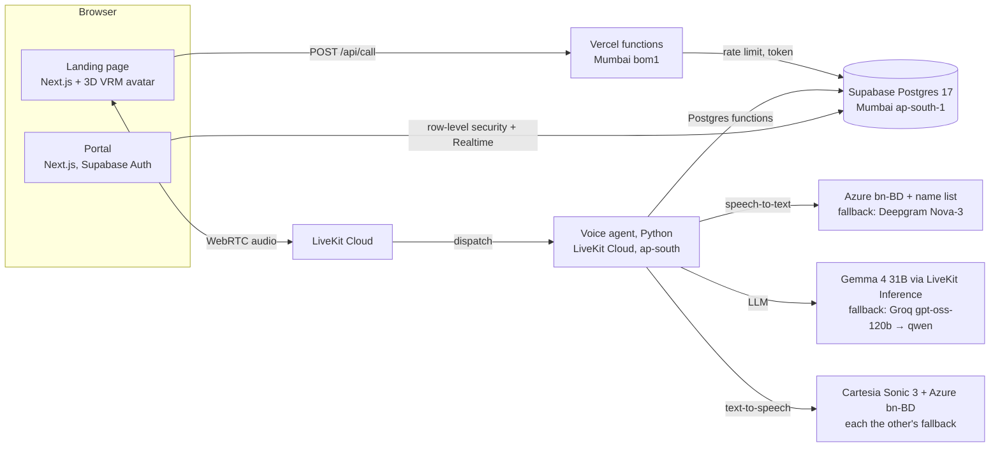

# ByteVoice Bangladesh — a Bangla AI receptionist for dental clinics

A working demo of StrategyByte's ByteVoice for Bangladesh: a landing page with a 3D receptionist, a **"Talk to our Bangla caller"** button that starts a live voice call in the browser, a voice agent that speaks everyday Dhaka Bangla and books, reschedules and cancels real appointments, and a portal where clinic staff see every call, its transcript and the structured data it produced.

| | Link |
|---|---|
| Landing page + Bangla caller | https://bytevoice-bd.vercel.app |
| Clinic portal | https://bytevoice-bd.vercel.app/portal (reviewer login is in the submission email) |
| Video overview (3 min) | _in the submission email_ |
| Decisions and testing | [docs/DECISIONS.md](docs/DECISIONS.md) · every guard: [docs/GUARDS.md](docs/GUARDS.md) |

The demo clinic is **রাকিব ডেন্টাল কেয়ার (Rakib Dental Care), Dhanmondi**: three doctors, eight services, Saturday–Thursday chambers, closed on Friday. All clinic, doctor and patient data is fictional.

**Try this:** pick a doctor and slot in *আমাদের চিকিৎসকবৃন্দ* on the landing page, press *কল শুরু করুন*, book it by voice, hang up — the slot turns *বুক হয়েছে* on the page and the call appears in the portal with its transcript, English translation and extracted fields. Then call again and cancel it with the same mobile number.

---

## Architecture



**One call, end to end**

1. The visitor presses the call button. `/api/call` checks a per-visitor rate limit (20/hour, IP stored only as a salted hash), creates a fresh LiveKit room and returns a 10-minute token with the agent dispatched into that room.
2. The agent joins, inserts a `calls` row, and greets in Bangla. Every spoken line is written to `transcript_turns` as it happens, so a live call shows up in the portal immediately.
3. Bookings go through **Postgres functions** (`book_appointment`, `reschedule_appointment`, `cancel_appointment`, `find_appointments`, `available_slots`), so the rules live in one place and each change is a single transaction. Every tool call is logged in `tool_invocations`.
4. When the caller hangs up, one LLM request turns the transcript into JSON (intent, names in Bangla and English, phone, reason, preferred time, outcome, flags, summaries, line-by-line English translation). It is validated with Pydantic and Postgres checks before it is stored in `call_extractions`.
5. The portal (Supabase Auth + row-level security) updates live through Supabase Realtime; the landing page's slot board refreshes when the call ends.

## Why these providers

Everything runs on free tiers. Each choice was tested, not assumed:

| Part | Choice | Why (what was tried) |
|---|---|---|
| Speech-to-text | **Azure `bn-BD`** with a phrase list of ~200 common Bangladeshi names, fallback **Deepgram Nova-3** `bn` | Callers' names were the weak spot: in a real call Deepgram heard "মকবুল হাসান" as "মুখ ভুল হাসান". On 50 synthetic clips (25 Bangladeshi names × 2 voices, "আমার নাম …") Azure got 44 names exactly right, Deepgram 38, and Azure with the name list 48. Deepgram's misses were often names split into ordinary words ("ফেরদৌস" → "ফের দোষ"). Azure `bn-BD` also got phone numbers right in Bangla, English and mixed ("জিরো ওয়ান সেভেন, ডাবল ওয়ান…"), so recognition no longer switches language for the number. A public Bangla benchmark (riverbornai, Sept 2026) ranks Soniox and Sarvam above Deepgram for streaming; both are paid, Azure was free here. Two safeguards: exact-silence audio gets inaudible noise (Azure otherwise sometimes missed the next sentence), and a watchdog replaces a stalled Azure session and asks the caller to repeat. Neither adds to normal reply time (measured: normal replies 2.26 s median vs 2.38 s before the switch). |
| LLM | **Gemma 4 31B on LiveKit Inference** (free monthly credit), fallback **Groq** `gpt-oss-120b` → `qwen3.8-27b` | Groq's free tier allows 8,000 tokens/minute per model; a Bangla prompt is ~2,800 tokens per request, so calls stalled on 429s. Gemma via LiveKit has no per-minute token cap, ~1s to first token, and the most natural Bangla of the free models tested. Gemini's free tier was too limited; Cerebras/Mistral free tiers allow only a few requests a minute. |
| Voice | **Cartesia Sonic 3 ("Kian")** and **Azure `bn-BD-PradeepNeural`**, order set by `TTS_ORDER`, each the other's fallback | Azure's `bn-BD` voices are trained on Bangladeshi speech (Google offers only `bn-IN`). Cartesia sounded the most natural in a side-by-side test and streams, so it starts speaking sooner. ElevenLabs' Bangladeshi voices are paid-only. If Cartesia's free credit runs out mid-call, LiveKit's `FallbackAdapter` switches to Azure instead of going silent. |
| Realtime transport | **LiveKit Cloud** + LiveKit Agents 1.8.10 | WebRTC, interruption handling, agent dispatch and hosting in one place. |
| Database / auth | **Supabase** Postgres 17, Mumbai | Closest region to Bangladesh, Auth, row-level security and Realtime included. |
| Web | **Next.js 16** on **Vercel** (Mumbai) | One app for landing page, APIs and portal. |

## Making it sound Bangladeshi, not Kolkata

- **Voice:** Bangladeshi-trained voices only (Cartesia, Azure `bn-BD`).
- **Prompt written in Bangla**, with Dhaka-style example replies and a list of words to avoid (নমস্কার, জল, স্নান, আজ্ঞে → আসসালামু আলাইকুম, পানি, গোসল, জি). Models copy the register of their instructions, so English instructions produced translated-sounding Bangla.
- **Safety net in code** (`agent/src/bangla.py`): those words are swapped before speech; `ডা.` is read as "ডাক্তার"; for Azure only, "সাড়ে পাঁচটা" is said as "পাঁচটা তিরিশে" because that voice mispronounces সাড়ে.
- **Times, dates and phone numbers are generated in code** ("রবিবার, ৮ নভেম্বর, বিকাল সাড়ে পাঁচটা", "শূন্য এক সাত এক দুই, তিন চার পাঁচ…"), so the LLM never formats or reads digits itself.
- English words are mixed in the way Dhaka speakers do: appointment, slot, scaling, root canal.

## Conversation behaviour

- Greeting → service → day and time (resolves "আগামী রবিবার বিকালে" from a calendar in the prompt; Friday is closed) → real free slots from the database → name, confirmed back → mobile number (said in parts is fine; read back digit by digit) → **full summary and "ঠিক আছে?" before booking** → confirmation → goodbye.
- Reschedule and cancel look the appointment up by phone, and the database checks the phone owns it.
- **No medical advice:** declines and offers an appointment or a staff callback. Emergencies (bleeding, swelling, fever) → go to a hospital now, and an `emergency` callback is created.
- **Off-topic questions** (weather, cricket, politics) are politely declined; asked who it is, it says honestly that it is the clinic's AI assistant. Repeated pranks or abuse → one warning, then it ends the call.
- Silence → "হ্যালো, আপনি কি শুনতে পাচ্ছেন?", then a polite hang-up. Calls are capped at 5 minutes.
- Interruptions: speaking over the agent stops it; short sounds like "জি"/"হুঁ" don't.

## Data model

14 tables + one view, in `supabase/migrations`. The portal's **Data model** page shows them with live row counts.

| Group | Tables |
|---|---|
| Clinic | `clinics`, `doctors`, `services`, `doctor_services`, `doctor_schedules` |
| Calls | `calls` (status, outcome, flags, summaries, `quality`), `transcript_turns` (Bangla + English, offset, interrupted, response time), `call_extractions`, `tool_invocations` |
| Bookings | `patients`, `appointments`, `appointment_events` (booked → rescheduled → cancelled, old/new time, which call), `callbacks` |
| Access | `staff` (admin / receptionist, linked to Supabase Auth) |

**Rules enforced by the database, not by the model**

- **Bookings take the treatment's real length:** slots start every 30 minutes, and each service has its own duration (check-up 20 min, scaling/filling/extraction 30 min, root canal/whitening 60 min). A 60-minute booking at 12:00 also closes 12:30 for that doctor; only start times where the whole treatment fits are offered.
- **No double booking:** an `EXCLUDE USING gist (doctor_id WITH =, tstzrange(starts_at, ends_at) WITH &&) WHERE status = 'scheduled'` constraint — tested by forcing an overlapping insert.
- **Phone numbers:** `normalize_bd_phone()` accepts Bangla or English digits, `+880`/`880`/`0` prefixes and stores only `+8801[3-9]XXXXXXXX` (CHECK constraint).
- **Families share phones in Bangladesh,** so a patient is matched on phone *and* name.
- Times are stored in UTC and shown in Asia/Dhaka.
- The extraction is not trusted blindly: invalid fields are dropped and listed in `validation_errors`, and an outcome of *booked* only counts if a booking actually happened in the database.

## Measured call quality

Every reply's timing comes from LiveKit's per-turn metrics and is stored on the call; the portal shows a **Call quality** box per call and "replied in 1.4s" on each agent line.

| Measured (local dev agent, Azure voice) | |
|---|---|
| Caller stops → agent starts speaking (average) | ~2.2–2.5 s |
| Breakdown | end-of-speech wait ~0.9 s · first LLM token ~0.9 s · first audio ~0.4 s |
| Interruptions | handled (stops and listens) |

The wait for the end of speech is deliberately 0.8 s (2 s while a phone number is being read) because Bangla speakers pause mid-sentence and shorter values cut callers off in testing. To make waits feel shorter, the agent starts drafting while the caller finishes, and says "জি, একটু দেখছি…" immediately when it checks the database. For context, the BanglaTalk research assistant reports 4.9 s end-to-end.

## Security

- No secrets in the repository: keys live in `.env.local` (git-ignored), LiveKit agent secrets and Vercel environment variables. `.env.example` lists the names.
- Row-level security on every table: signed-out users read nothing; staff see only their clinic; only the agent's database role can call the booking functions.
- The public slot board (`/api/availability`) returns doctor, time and booked/free only — no patient data.
- Rate limit on starting calls, 5-minute call cap, short-lived room-scoped tokens.

## Repository

```
agent/      Python voice agent (LiveKit Agents)
  src/agent.py       session, tools, timing, end-of-call processing
  src/prompt.py      Bangla system prompt
  src/bangla.py      spoken dates/times/phones, word fixes, spoken-number parser
  src/voice.py       STT / LLM / TTS chains with fallbacks
  src/extraction.py  post-call structured extraction + validation
  src/db.py          asyncpg access to the Postgres functions
web/        Next.js 16 app: landing page, /api/call, /api/availability, /portal
supabase/   SQL migrations and seed (the schema is the source of truth)
scripts/    shrink_vrm.py — shrinks VRM textures without dropping VRM data
docs/       CREDITS.md
```

## Running it locally

```bash
# database: apply supabase/migrations/*.sql in order, then supabase/seed.sql
cd agent && cp ../.env.example .env.local   # fill in keys
uv sync && uv run src/agent.py download-files
AGENT_NAME=bytevoice-bd-dev uv run src/agent.py dev     # or: uv run src/agent.py console

cd ../web && npm install                    # .env.local with LiveKit/Supabase values,
LIVEKIT_AGENT_NAME=bytevoice-bd-dev npm run dev   # then open http://localhost:3000
```

Deploy: `lk agent create --project <project> --secrets-file … --region ap-south` for the agent; `vercel deploy --prod` from `web/` (region pinned to `bom1` in `vercel.json`).

## Honest limitations

- **Correcting one digit** ("শেষেরটা ওয়ান হবে") isn't understood: the caller has to say the whole number again. After a few failed tries the agent offers a staff callback instead of looping.
- **Rare names** can still be misspelt; the read-back catches most, and unconfirmed names are flagged for staff.
- **Demo calls stop at 5 minutes** to protect the free credits.
- **Latency is about 2 s** per reply on free models; a paid real-time model or a turn detector trained on Bangla would cut the end-of-speech wait.
- **Free tiers:** Cartesia's free plan covers about 20 minutes of speech a month and LiveKit Inference about $2.50 of LLM credit; both fall back automatically (Azure voice, Groq LLM) when exhausted.
- Lip movement on the 3D avatar is driven by "agent is speaking" plus audio level, not true phoneme lip-sync.
- No recordings are stored (privacy by default); the `recording_url` column is ready for it.
- Not production hardening: no SMS confirmations, no clinic-software integration, a single demo clinic.

## Credits

3D character: *Sakurada Fumiriya* by pixiv (VRoid), used under its VRoid Hub licence (free use, credit not required). Everything else is original or open-source; see [docs/CREDITS.md](docs/CREDITS.md). Every guard and corner case is listed in [docs/GUARDS.md](docs/GUARDS.md). What I decided and how each choice was tested: [docs/DECISIONS.md](docs/DECISIONS.md). Code was written with help from Claude (Anthropic); I can explain every part of it.
